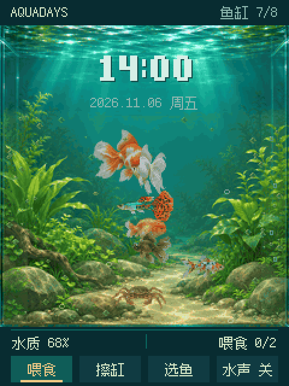
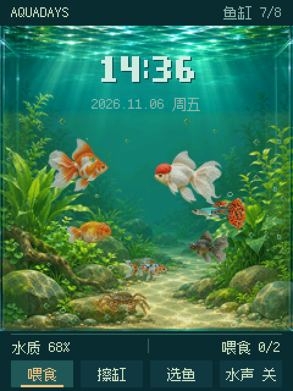
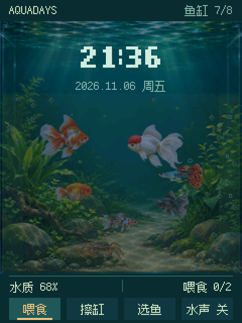
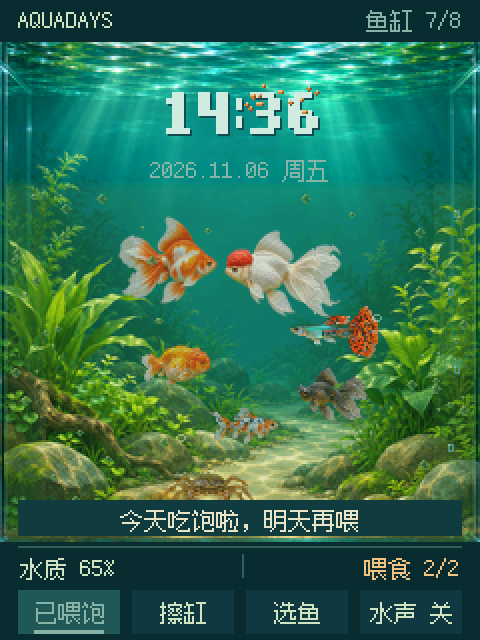
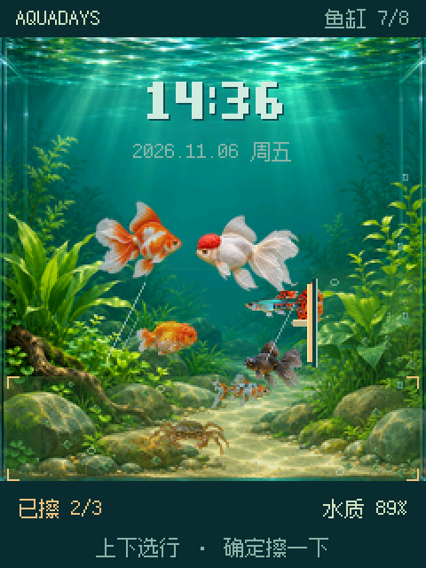
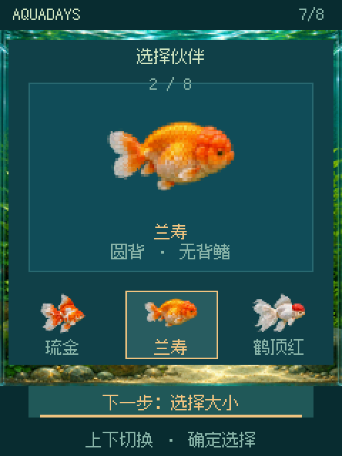
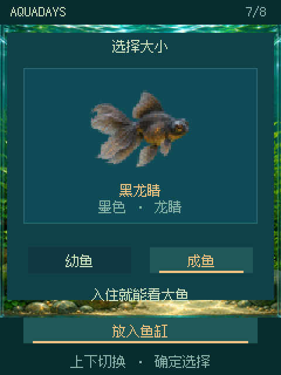
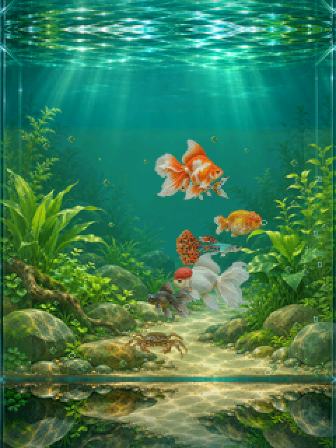
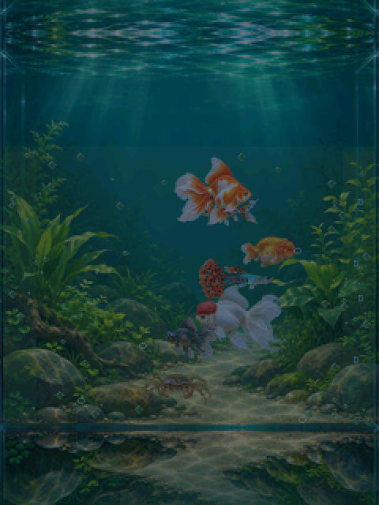

# AquaDays · 一缸时光

**一个装在 [FoloToy AI Passport](https://ai-passport.folotoy.cn/) 上的掌上小鱼缸。**
金鱼在缸里慢慢游，后面是当天的时间和日期；每天可以喂两次食、擦一擦玻璃，挑选喜欢的鱼放进缸里。不操作的时候，它就是一个安静的桌面摆件。

*A handheld pixel aquarium for the FoloToy AI Passport (ESP32-C3, 240×320 screen, 3 buttons). Runs offline as native firmware; a browser preview is included.*

<p align="center">
  
</p>

## 效果图

以下截图都由固件的同一份 C 绘制代码在电脑上生成，和设备屏幕上的像素一致（放大 2 倍显示）。

| 白天 | 夜晚 | 喂食 | 擦缸 |
|:---:|:---:|:---:|:---:|
|  |  |  |  |
| 时间显示在鱼缸后景，鱼从数字前游过 | 18:00 之后自动入夜，鱼和水草一起变暗 | 一撮鱼食撒在水面，慢慢沉下去 | 玻璃分上中下三行，一下擦一行 |

| 选鱼 | 选大小 | 沉浸模式（白天） | 沉浸模式（夜晚） |
|:---:|:---:|:---:|:---:|
|  |  |  |  |
| 八种伙伴可选 | 幼鱼会随着喂食慢慢长大 | 3 分钟不操作，顶部和底部隐藏 | 整块屏幕只剩一缸水 |

## 它是用在什么上面的

AquaDays 是为 **FoloToy AI Passport** 写的独立固件。这是一块带屏幕的小硬件：

| 部件 | 规格 |
|---|---|
| 主控 | ESP32-C3（单核 RISC-V 160 MHz，无浮点单元，无 PSRAM） |
| 屏幕 | 240×320 竖屏 ST7789 |
| 按键 | 上 / 下 / 确定，三个键 |
| 声音 | ES8311 音频芯片 + 小喇叭 |
| 存储 | 8MB flash |

游戏刷进设备后**完全离线运行**，不需要联网，也不需要手机。没有设备也能玩：仓库里有一个浏览器预览版，画面和设备一致。

参考了社区作品 [plays/1179](https://ai-passport.folotoy.cn/plays/1179/) 的产品体验；界面、美术和代码都是自己做的。

## 玩法

- **上 / 下键**：切换选项（首页按钮、擦缸的行、要选的鱼）。
- **确定键**：执行。**长按确定**：返回首页。
- **喂食**：每天两份。鱼会游过去吃，吃到会冒碎屑，没吃完的落在沙上。
- **擦缸**：玻璃上会慢慢长出淡绿的雾和藻斑，三下擦干净；每天第一次照料会盖一个"照料章"，提示 10 秒后消失。
- **选鱼**：琉金、兰寿、鹤顶红、黑龙睛、珍珠鳞、朱文金、孔雀鱼，外加一只在缸底横着走的螃蟹，缸里最多 8 位。
- **水声**（首页第 4 个按钮，默认关）：很轻的打氧机声，一串细小气泡加偶尔一个大泡。喂食时的"扑通"声始终会响。
- **沉浸模式**：3 分钟不按键，顶部和底部的文字按钮都隐藏，只剩鱼缸；按任意键恢复。

试听水声：[water-sound-preview.m4a](docs/design/sound/water-sound-preview.m4a)（0–3 秒是扑通声，3 秒后是打氧机声）。

## 快速开始

### 在浏览器里预览（不需要设备）

```sh
python3 -m http.server 8791 --bind 127.0.0.1
```

打开 <http://127.0.0.1:8791/prototype/>。键盘方向键 = 上下，Enter = 确定，Esc = 返回。页面上可以切换 1×/2× 显示、模拟日期，以及"演示：3 分钟无操作"。

### 运行测试

```sh
node tests/game.test.cjs     # 18 项：规则、动画、字库、资源格式、声音开关
```

### 编译并刷进设备

需要 [ESP-IDF v5.5.3](https://docs.espressif.com/projects/esp-idf/en/v5.5.3/esp32c3/)。

```sh
cd firmware
. ~/esp/esp-idf-v5.5.3/export.sh
touch main/main.c && idf.py build
python -m esptool --chip esp32c3 -p /dev/cu.usbmodem1101 -b 460800 write_flash \
  --flash_mode dio --flash_size 8MB --flash_freq 80m 0x10000 build/AquaDays.bin
```

> ⚠️ **只写 0x10000 的应用分区。** 不要执行 `idf.py erase-flash`，也不要写 bootloader 或分区表，否则会抹掉设备的身份数据。刷之前建议先备份原来的应用分区，以便还原。

设备不联网，开机时间 = 编译时刻 + 开机后经过的时间，所以每次编译前 `touch main/main.c`。

## 技术要点

- **两份实现，一套规则**：浏览器原型（`prototype/`，原生 JS + Canvas）先把玩法和画面做好，再一行一行移植成 C（`firmware/main/`）。用同一个随机种子跑同样的场景，电脑上逐像素对比两边的画面；声音两边逐采样点一致。
- **不用图形库**：直接在 240×320 的 RGB565 画布上画，分 40 行一条用 DMA 送到屏幕。芯片没有浮点单元，明暗和半透明都用查表和整数运算，每帧约 68 ms（预算 83 ms，12 帧/秒）。
- **声音实时合成**：滤波噪声加正弦气泡，现场计算，不占存储，听不出循环。
- **资源**：鱼只存朝右的帧，镜像、抬头低头、远近和昼夜明暗都在绘制时完成；固件约 1.75MB。

## 目录

| 位置 | 内容 |
|---|---|
| `prototype/` | 浏览器原型：`game.js` 规则、`render.js` 画面、`sound.js` 声音、`assets/` 导出给设备的位图和字库 |
| `firmware/` | ESP-IDF 固件；`main/` 游戏代码，`host/` 电脑端出图和出声工具，`components/bsp/` 板级驱动 |
| `tests/` | 规则与资源测试 |
| `docs/screenshots/` | 本页截图 |
| `docs/design/` | 各版本设计稿、截图和试听音频 |
| `AI_readme.md` | 详细说明书：参数、日志、验证方法和优化记录 |

## 版本记录

- **水声**：首页加"水声"开关，默认关；喂食扑通声；水声从流水改为很轻的打氧机声。
- **沉浸模式**：照料章 10 秒后消失；3 分钟不操作隐藏顶部和底部。
- **固件**：照原型移植到 ESP32-C3，真机运行。
- **V7 喂食与擦缸**：三行擦缸、刮水器与反光；鱼食撒落、下沉、沉底。[详情](docs/design/care-v7/README.md)
- **V6 游动**：分前后两层、椭圆避让、掉头过渡帧、行进波摆尾、螃蟹横行。[详情](docs/design/motion-v6/README.md)
- **V5**：加入孔雀鱼与螃蟹，八种伙伴。更早的版本在 `docs/design/` 中保留。

## 许可与致谢

- 代码：[Apache License 2.0](LICENSE)。
- 像素字体：[Fusion Pixel Font](https://github.com/TakWolf/fusion-pixel-font)（SIL OFL 1.1）的 221 字子集，见 [`prototype/font-licenses/`](prototype/font-licenses/README.md)。
- 板级驱动 `firmware/components/bsp/` 来自 FoloToy `ai-passport` 工程（MIT），未修改。
- 鱼种混养是游戏化设定，不代表真实的饲养建议。
